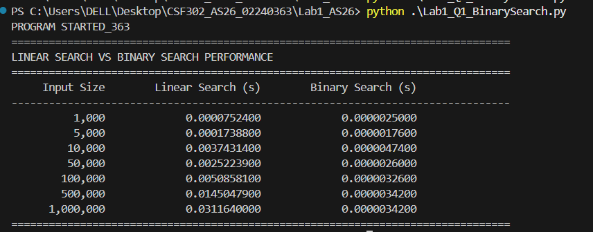
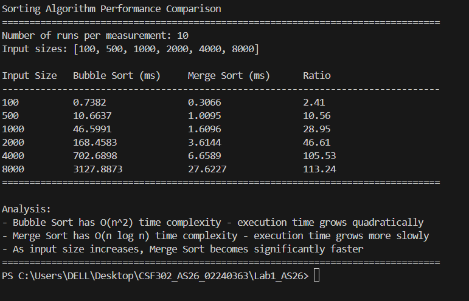
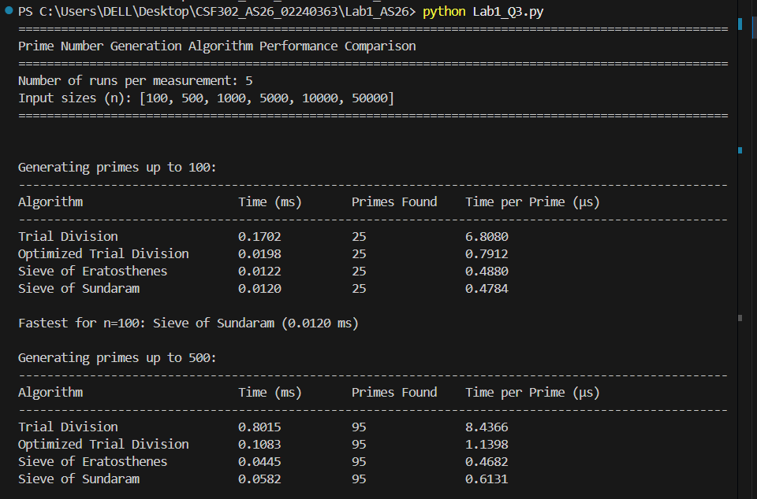
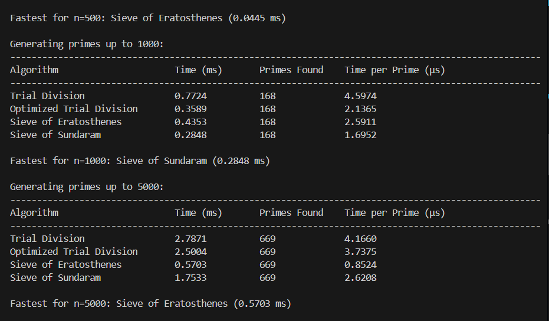
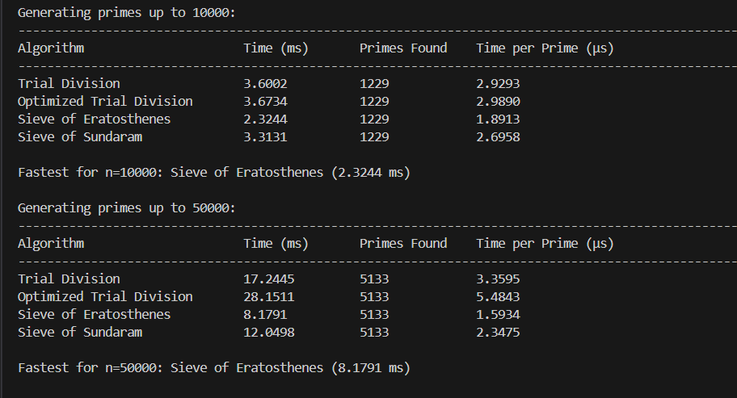
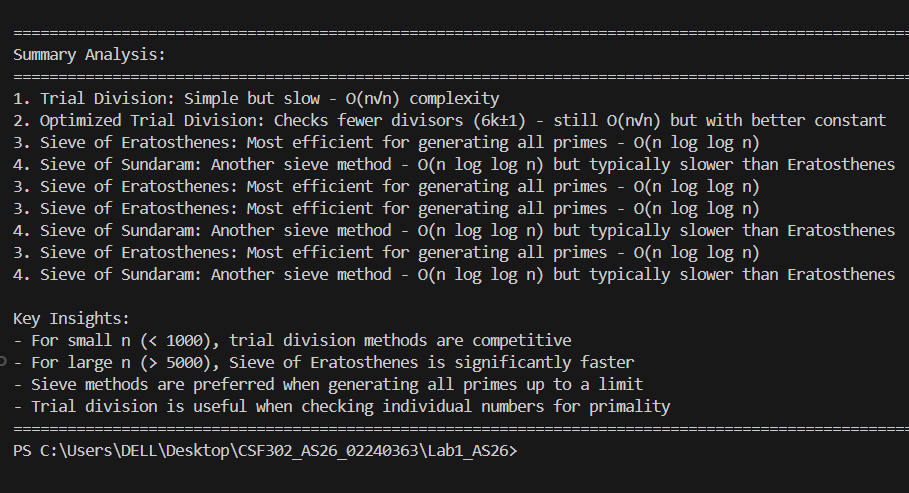
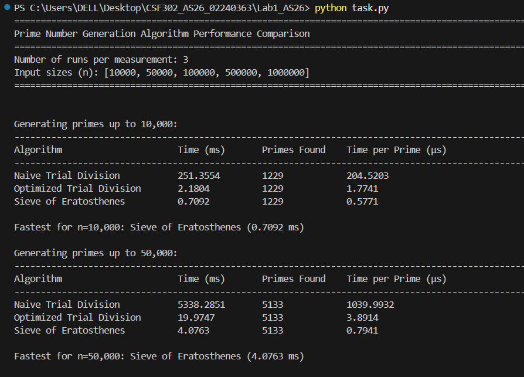
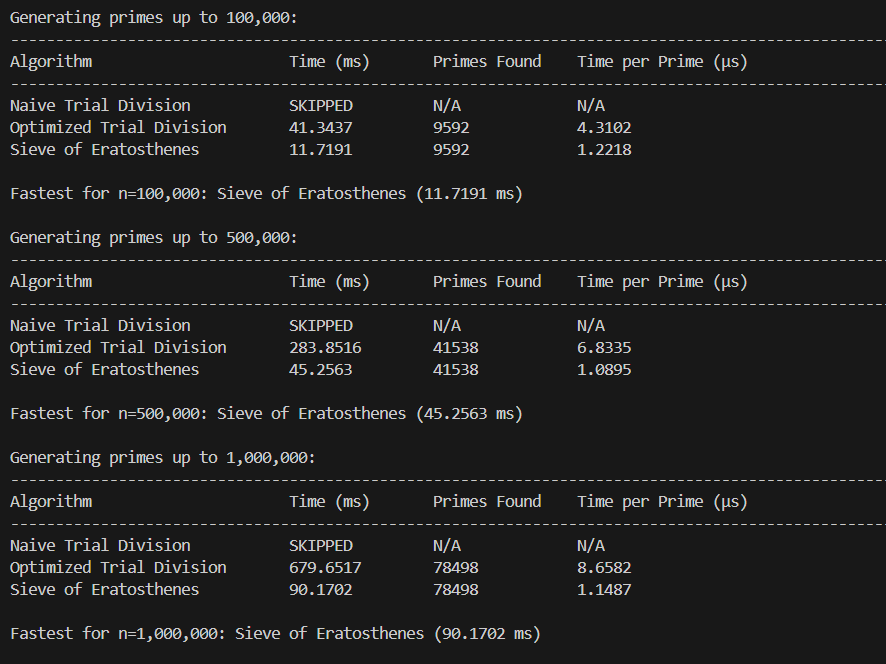
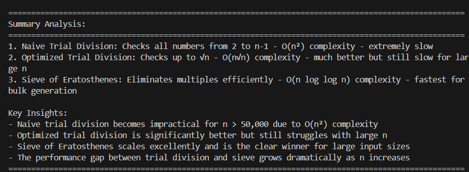

# Lab: Empirical Growth Rate Measurement and Algorithm Benchmarking

## Aims and Objectives

**Aim:**
For the empirical comparison of algorithm efficiency in accordance with their time complexities, showing how the complexity analysis of the algorithms can be applied in practice.

**Objectives:**
- Overall aim to empirically measure algorithm performance
- Specific objectives for each experiment (search, sort, prime generation)
- Focus on understanding practical impact of complexity analysis

## Question_1

This  experiment demonstrates the performance difference between Linear Search and Binary Search.

Linear Search is simple and can work directly on an unsorted dataset, but its execution time increases approximately linearly as the dataset size increases.

Binary Search requires a sorted dataset but is much more efficient for searching large datasets because its search space is reduced by half at every step.

Therefore, for large sorted datasets, Binary Search provides significantly better search performance than Linear Search.

## out put

## Question_2
From this sorting algorithm experiment, I found out that Bubble Sort gets much slower as the size of the data increases, since it has O(n²) time complexity, whereas Merge Sort is faster since it has O(n log n) time complexity. When there is a small amount of data, there isn’t a great difference in performance, but when there is a lot of data, then Merge Sort can be much faster compared to Bubble Sort. This experiment made me realize that time complexity matters in real life applications.

## Question_3
Algorithms implemented:

Trial Division - Basic O(n√n) approach
Optimized Trial Division - O(n√n) with 6k±1 optimization
Sieve of Eratosthenes - O(n log log n) - most efficient for bulk generation
Sieve of Sundaram - O(n log log n) alternative sieve method

**The Sieve of Eratosthenes is the most efficient algorithm to find prime numbers**, particularly when the number becomes larger. Trial division is efficient in case of smaller numbers; however, it is not the best algorithm to use for larger numbers. The sieve is a more efficient algorithm because it eliminates those numbers that are not prime very quickly. This experiment indicates that the sieve algorithms are more efficient by a factor of 2–3.

## Task 
Algorithms implemented:

Naive Trial Division - Checks all numbers from 2 to n-1 (O(n²))
Optimized Trial Division - Checks up to √n (O(n√n))
Sieve of Eratosthenes - Eliminates multiples efficiently (O(n log log n))

Naive trial division becomes very slow when the input size gets large because it has O(n²) complexity. Optimized trial division is much faster, about 100 times faster, but it can still be slow for very large numbers. The Sieve of Eratosthenes is the fastest method, being about 8 times faster than optimized trial division at 1 million. This shows that as the input size increases, choosing an efficient algorithm like the sieve becomes very important.

## Conclusion

- Important conclusions from each algorithm classification with performance metrics 
- Proof that theoretical complexity determines the actual performance of algorithms 
- The crucial role of selecting proper algorithms for large-scale systems 
- Insights into improvements in complexity classes vs constant factor improvements

