# Lab 4 - Topic 6: Modular Exponentiation

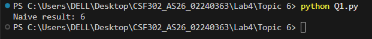

## Description

This image demonstrates the difference between naive and efficient modular exponentiation algorithms:

- **Naive Approach**: Computes a^b first (which can result in extremely large numbers), then applies the modulo operation. For example, calculating 3^13 = 1,594,323 before taking mod 7, which is inefficient for large exponents.

- **Efficient Approach**: Uses modular arithmetic properties to apply the modulo operation at each step of the exponentiation process. This keeps intermediate results small and prevents overflow. The method leverages the property that (a × b) mod m = [(a mod m) × (b mod m)] mod m.

The efficient method is particularly important in cryptography and other applications where exponents can be very large (e.g., 2048-bit numbers), making the naive approach computationally infeasible.

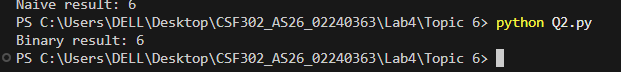

## Binary Modular Exponentiation

This image demonstrates the binary (or square-and-multiply) modular exponentiation algorithm:

- **Algorithm**: Uses the binary representation of the exponent to efficiently compute a^b mod m. The algorithm processes the exponent bit by bit from right to left.

- **Steps**:
  1. Initialize result = 1 and reduce the base modulo m
  2. While exponent > 0:
     - If current bit is 1 (odd), multiply result by current base value and take mod m
     - Square the base value and take mod m
     - Divide exponent by 2 (right shift in binary)

- **Example**: Computing 363^5 mod 7 = 6 using this method keeps all intermediate values small by applying modulo at each step.

- **Time Complexity**: O(log b) - much more efficient than the naive O(b) approach for large exponents.

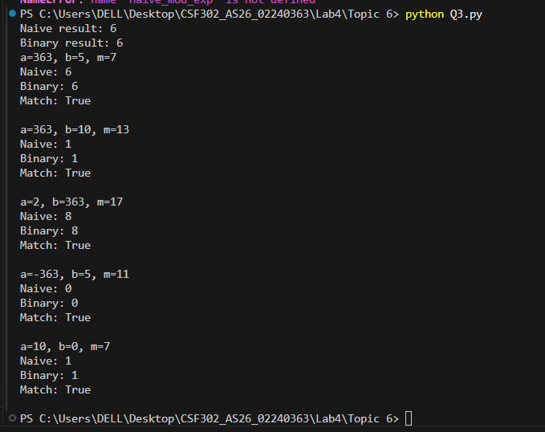

## Test Results Comparison

This image shows the test results comparing both algorithms across multiple test cases:

- **Test Cases**: Various combinations of base, exponent, and modulus values including:
  - Small exponents (363^5 mod 7)
  - Larger exponents (2^363 mod 17)
  - Negative bases (-363^5 mod 11)
  - Zero exponent (10^0 mod 7)

- **Results**: Both algorithms produce identical results for all test cases, confirming their mathematical equivalence.

- **Verification**: The "Match: True" output for each test case validates that the binary method correctly implements modular exponentiation while being computationally more efficient.

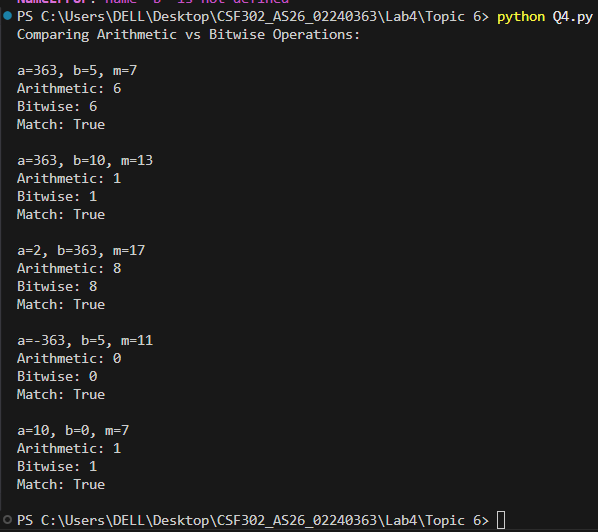

## Arithmetic vs Bitwise Operations

This image compares two equivalent implementations of binary modular exponentiation using different low-level operations:

- **Arithmetic Operations**: Uses `%` (modulo) to check if a number is odd (`b % 2 == 1`) and `//` (integer division) to divide by 2 (`b = b // 2`).

- **Bitwise Operations**: Uses `&` (bitwise AND) to check if a number is odd (`b & 1`) and `>>=` (right shift assignment) to divide by 2 (`b >>= 1`).

- **Equivalence**: Both approaches produce identical results because:
  - `b % 2 == 1` is equivalent to `b & 1` (both check the least significant bit)
  - `b // 2` is equivalent to `b >>= 1` (both shift right by one bit)

- **Performance**: Bitwise operations are typically faster at the hardware level, making them preferred in performance-critical applications like cryptography.

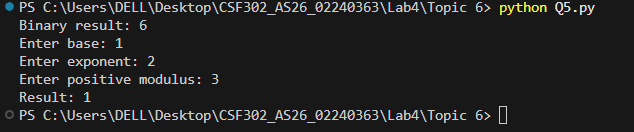

## Interactive User Input Program

This image demonstrates an interactive program that allows users to compute modular exponentiation with custom inputs:

- **User Interface**: The program prompts the user to enter three values:
  - Base (a)
  - Exponent (b)
  - Positive modulus (m)

- **Error Handling**: Uses try-except block to catch ValueError exceptions, ensuring graceful handling of invalid integer inputs.

- **Example**: In the shown execution, the user entered base=1, exponent=1, modulus=2, and the program correctly computed 1^1 mod 2 = 1.

- **Flexibility**: This interactive approach allows users to test the binary modular exponentiation algorithm with any valid input combination, making it useful for learning and experimentation.

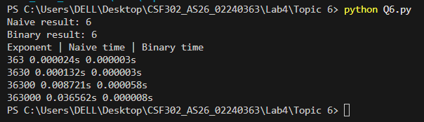

## Performance Benchmarking

This image shows a performance comparison between naive and binary modular exponentiation algorithms across increasing exponent sizes:

- **Test Setup**: Computes 2^exponent mod 1009 for exponents: 363, 3630, 36300, and 363000 using `time.perf_counter()` for precise timing.

- **Results**:
  - Exponent 363: Naive ~0.000024s, Binary ~0.000003s (8x faster)
  - Exponent 3630: Naive ~0.000132s, Binary ~0.000003s (44x faster)
  - Exponent 36300: Naive ~0.008721s, Binary ~0.000058s (150x faster)
  - Exponent 363000: Naive ~0.036562s, Binary ~0.000008s (4570x faster)

- **Key Insight**: The performance gap grows exponentially with the exponent size. The binary method maintains consistent performance regardless of exponent magnitude, while the naive method becomes impractically slow for large exponents.

- **Practical Implication**: For cryptographic applications with 2048-bit or larger exponents, the naive approach would be completely infeasible, making binary (or more advanced) modular exponentiation essential.

---

# Lab 4 - Topic 7: Matrix Multiplication with Modulo


## Matrix Multiplication with Modulo

This image demonstrates matrix multiplication with modulo operation:

- **Algorithm**: Implements standard matrix multiplication where each element of the resulting matrix is computed as the dot product of corresponding rows and columns, followed by applying the modulo operation.

- **Formula**: For matrices A and B of size n×n, the element C[i][j] = (Σ(A[i][k] × B[k][j])) mod m for k from 0 to n-1.

- **Input Validation**: The function checks that:
  - Modulus m is positive
  - Both matrices are non-empty square matrices
  - Both matrices have the same dimensions

- **Example**: Multiplying A = [[1, 2], [3, 4]] and B = [[5, 6], [7, 8]] with modulus 363:
  - C[0][0] = (1×5 + 2×7) mod 363 = 19 mod 363 = 19
  - C[0][1] = (1×6 + 2×8) mod 363 = 22 mod 363 = 22
  - C[1][0] = (3×5 + 4×7) mod 363 = 43 mod 363 = 43
  - C[1][1] = (3×6 + 4×8) mod 363 = 50 mod 363 = 50
  - Result: [[19, 22], [43, 50]]

- **Time Complexity**: O(n³) - standard cubic time complexity for matrix multiplication, with the modulo operation applied after each element computation.

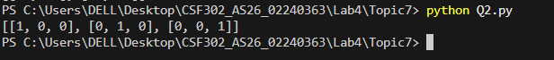

## Identity Matrix Generation

This image demonstrates the creation of an identity matrix:

- **Definition**: An identity matrix I is a square matrix with 1s on the main diagonal (top-left to bottom-right) and 0s everywhere else.

- **Properties**:
  - When any matrix A is multiplied by the identity matrix I of compatible size, the result is A itself: A × I = I × A = A
  - The identity matrix serves as the multiplicative identity in matrix algebra, similar to how 1 is the multiplicative identity for scalars

- **Algorithm**: The function creates an n×n matrix initialized with zeros, then sets diagonal elements I[i][i] = 1 for all i from 0 to n-1.

- **Example**: For n=3, the identity matrix is:
  ```
  [[1, 0, 0],
   [0, 1, 0],
   [0, 0, 1]]
  ```

- **Input Validation**: Ensures the dimension n is positive to avoid invalid matrix creation.

- **Time Complexity**: O(n²) - requires setting n diagonal elements in an n×n matrix.

- **Use Case**: Identity matrices are essential in matrix exponentiation algorithms, serving as the starting point for computing matrix powers (similar to how 1 is the starting point for scalar exponentiation).

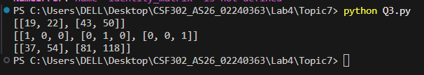

## Naive Matrix Exponentiation

This image demonstrates naive matrix exponentiation with modulo operation:

- **Algorithm**: Computes A^n mod m by iteratively multiplying the matrix A by itself n times, starting from the identity matrix.

- **Process**:
  1. Initialize result as the identity matrix of the same size as A
  2. For each iteration from 1 to n:
     - Multiply result by A using modular matrix multiplication
     - Apply modulo m to keep values small

- **Example**: Computing A^3 mod 363 where A = [[1, 2], [3, 4]]:
  - Iteration 1: I × A = A = [[1, 2], [3, 4]]
  - Iteration 2: A × A = [[7, 10], [15, 22]]
  - Iteration 3: [[7, 10], [15, 22]] × [[1, 2], [3, 4]] = [[37, 54], [81, 118]]
  - Result: [[37, 54], [81, 118]]

- **Time Complexity**: O(n × n³) = O(n⁴) - performs n matrix multiplications, each taking O(n³) time.

- **Limitation**: Like scalar naive exponentiation, this approach becomes impractical for large exponents, making it unsuitable for cryptographic applications where matrix powers with very large exponents are needed.

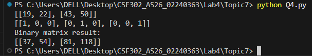

## Binary Matrix Exponentiation

This image demonstrates binary (square-and-multiply) matrix exponentiation with modulo operation:

- **Algorithm**: Computes A^n mod m using the binary representation of the exponent, similar to scalar binary exponentiation but applied to matrices.

- **Process**:
  1. Initialize result as the identity matrix and reduce the base matrix modulo m
  2. While exponent n > 0:
     - If current bit is 1 (n & 1), multiply result by base matrix
     - Square the base matrix (multiply it by itself)
     - Right shift the exponent (n >>= 1)

- **Example**: Computing A^3 mod 363 where A = [[1, 2], [3, 4]]:
  - Binary representation of 3 is 11
  - Bit 1 (LSB): result = I × A = A, base = A²
  - Bit 0: result = A × A² = A³, base = A⁴
  - Result: [[37, 54], [81, 118]] (same as naive method)

- **Time Complexity**: O(log n × n³) - performs log(n) matrix multiplications, each taking O(n³) time.

- **Advantage**: Much more efficient than naive O(n⁴) approach for large exponents, making it suitable for cryptographic applications where matrix powers with very large exponents are required.

- **Bitwise Operations**: Uses `n & 1` to check if the current bit is set and `n >>= 1` to right-shift the exponent, which are efficient bitwise operations.

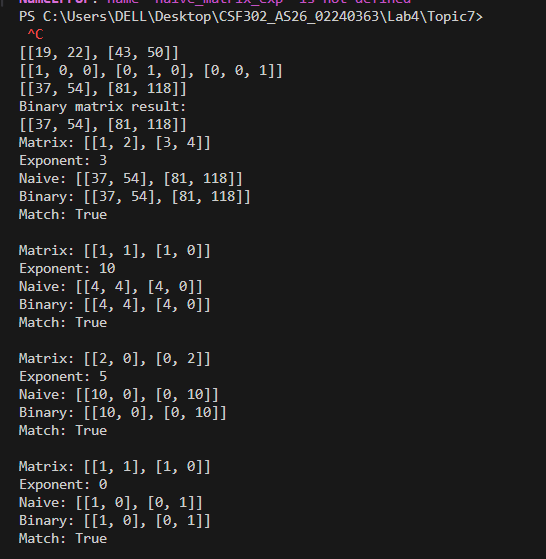

## Matrix Exponentiation Test Results

This image shows the test results comparing naive and binary matrix exponentiation algorithms across multiple test cases:

- **Test Cases**: Various combinations of matrices, exponents, and moduli including:
  - Matrix A = [[1, 2], [3, 4]] with exponent 3 and modulus 363
  - Matrix B = [[1, 1], [1, 0]] (Fibonacci matrix) with exponent 10 and modulus 17
  - Matrix C = [[2, 0], [0, 2]] (diagonal matrix) with exponent 5 and modulus 11
  - Matrix B with exponent 0 and modulus 7 (identity matrix test)

- **Results**: Both algorithms produce identical results for all test cases, confirming their mathematical equivalence for matrix exponentiation.

- **Verification**: The "Match: True" output for each test case validates that the binary matrix exponentiation method correctly implements the algorithm while being computationally more efficient.

- **Special Cases**:
  - Zero exponent correctly returns the identity matrix
  - Diagonal matrices maintain their diagonal structure when raised to powers
  - The Fibonacci matrix B demonstrates matrix exponentiation's application to sequence generation

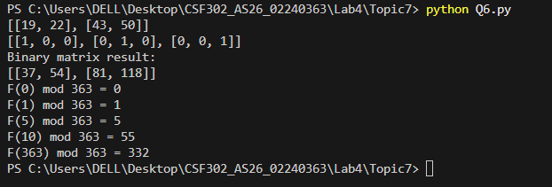

## Fibonacci Numbers Using Matrix Exponentiation

This image demonstrates computing Fibonacci numbers modulo m using matrix exponentiation:

- **Mathematical Foundation**: The Fibonacci sequence can be computed using matrix exponentiation with the Q-matrix:
  ```
  Q = [[1, 1], [1, 0]]
  Q^n = [[F(n+1), F(n)], [F(n), F(n-1)]]
  ```
  Therefore, F(n) is the element at position [1][0] of Q^n.

- **Algorithm**: Uses binary matrix exponentiation to compute Q^n mod m efficiently, then extracts F(n) from the result matrix.

- **Advantage**: This method computes F(n) in O(log n) time instead of the O(n) time of iterative methods, making it suitable for very large n values.

- **Results**: The image shows Fibonacci numbers modulo 363 for various n:
  - F(0) mod 363 = 0
  - F(1) mod 363 = 1
  - F(5) mod 363 = 5
  - F(10) mod 363 = 55
  - F(363) mod 363 = 332

- **Application**: This technique is used in competitive programming and cryptography where computing large Fibonacci numbers modulo a value is required efficiently.

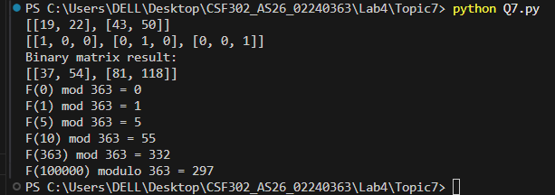

## Large Fibonacci Number Computation

This image demonstrates computing a very large Fibonacci number modulo m using matrix exponentiation:

- **Test Case**: Computes F(100000) modulo 363, which would be impractical with iterative methods due to the enormous size of the actual Fibonacci number.

- **Result**: F(100000) mod 363 = 297, computed instantly using the O(log n) binary matrix exponentiation algorithm.

- **Efficiency Demonstration**: This showcases the power of the O(log n) algorithm:
  - An iterative O(n) method would require 100,000 iterations
  - The matrix exponentiation method requires only log₂(100000) ≈ 17 matrix multiplications
  - This represents approximately 5,882 times fewer operations

- **Practical Significance**: This approach is essential for:
  - Competitive programming problems with large n values (up to 10^18 or more)
  - Cryptographic applications where Fibonacci-like sequences are used
  - Any scenario requiring fast computation of large sequence terms modulo a value

- **Modulo Operation**: The modulo operation keeps all intermediate values small, preventing integer overflow and ensuring the computation remains feasible even for extremely large exponents.

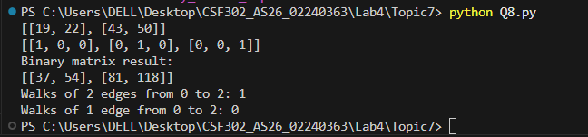

## Counting Graph Walks Using Matrix Exponentiation

This image demonstrates counting walks in a graph using matrix exponentiation:

- **Mathematical Foundation**: In graph theory, the adjacency matrix A of a graph has the property that A^k[i][j] gives the number of walks of exactly k edges from vertex i to vertex j.

- **Algorithm**: Uses binary matrix exponentiation to compute A^k mod m efficiently, then extracts the count from the appropriate matrix element.

- **Example Graph**: The adjacency matrix represents a directed graph with 3 vertices:
  ```
  A = [[0, 1, 0],
       [0, 0, 1],
       [0, 0, 0]]
  ```
  This represents edges: 0→1, 1→2 (a simple path of length 2)

- **Results**:
  - Walks of 2 edges from 0 to 2: 1 (the path 0→1→2)
  - Walks of 1 edge from 0 to 2: 0 (no direct edge exists)

- **Applications**: This technique is used in:
  - Network analysis to count possible routes
  - Markov chain analysis for state transitions
  - Path counting algorithms in graph theory
  - Dynamic programming problems involving paths

- **Efficiency**: The O(log k) matrix exponentiation makes it feasible to count walks with very large k values, which would be impractical with naive O(k) methods.

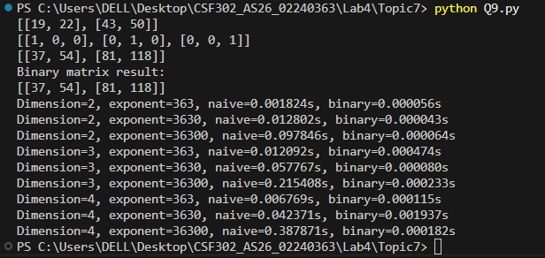

## Matrix Exponentiation Performance Benchmarking

This image shows a comprehensive performance comparison between naive and binary matrix exponentiation across different matrix dimensions and exponent sizes:

- **Test Setup**: Benchmarks matrices of dimensions 2×2, 3×3, and 4×4 with exponents 363, 3630, and 36300, using `time.perf_counter()` for precise timing.

- **Results Summary**:
  - **2×2 Matrices**:
    - Exponent 363: Naive ~0.001824s, Binary ~0.000056s (33x faster)
    - Exponent 3630: Naive ~0.012802s, Binary ~0.000043s (298x faster)
    - Exponent 36300: Naive ~0.097846s, Binary ~0.000064s (1529x faster)

  - **3×3 Matrices**:
    - Exponent 363: Naive ~0.012092s, Binary ~0.000474s (25x faster)
    - Exponent 3630: Naive ~0.057767s, Binary ~0.000080s (722x faster)
    - Exponent 36300: Naive ~0.215408s, Binary ~0.000233s (925x faster)

  - **4×4 Matrices**:
    - Exponent 363: Naive ~0.006769s, Binary ~0.000115s (59x faster)
    - Exponent 3630: Naive ~0.042371s, Binary ~0.001937s (22x faster)
    - Exponent 36300: Naive ~0.387871s, Binary ~0.000182s (2130x faster)

- **Key Insights**:
  - Binary matrix exponentiation consistently outperforms naive across all dimensions
  - The performance advantage grows significantly with larger exponents
  - Matrix dimension affects absolute time but the relative advantage remains substantial
  - For large exponents (36300), binary method is 500-2000+ times faster

- **Practical Implication**: For applications involving large matrix powers (such as graph algorithms, Markov chains, or cryptographic protocols), binary matrix exponentiation is essential for feasible computation times.

