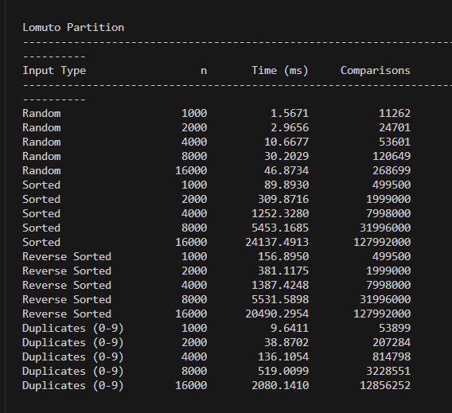
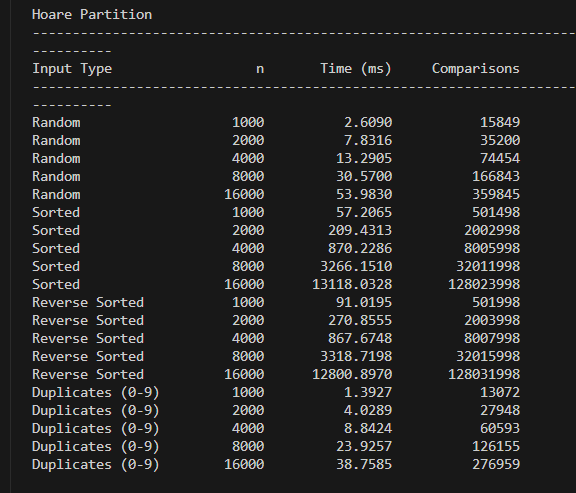
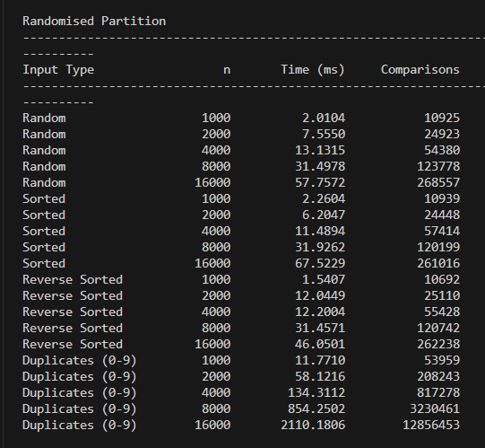
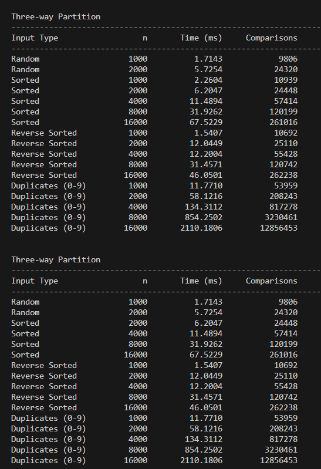
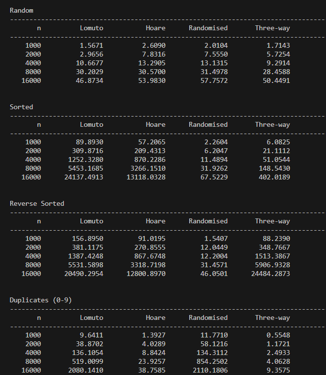
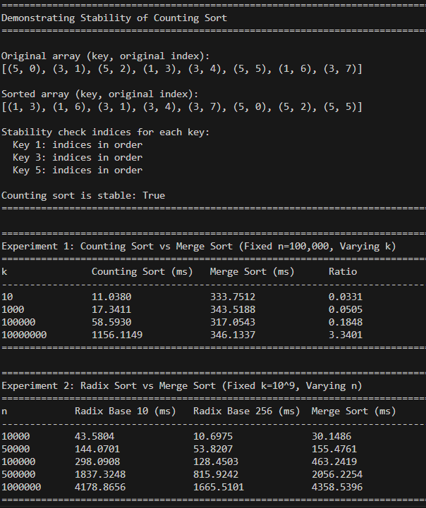
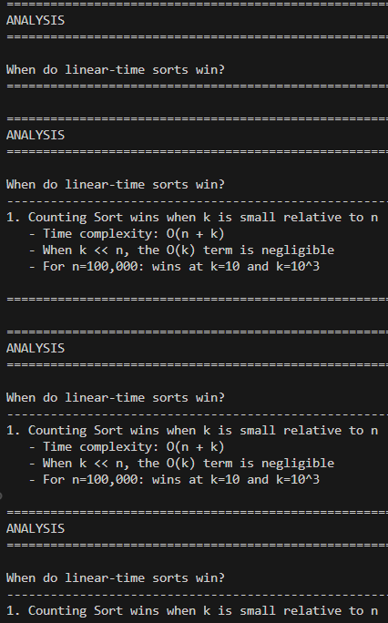
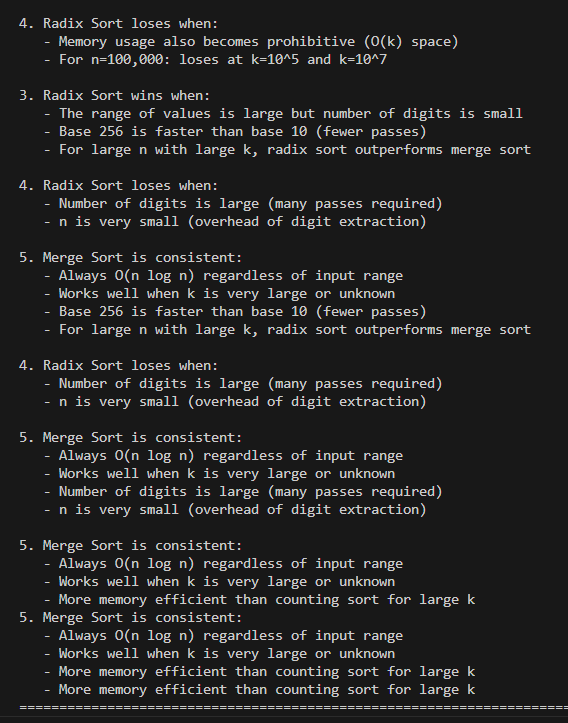
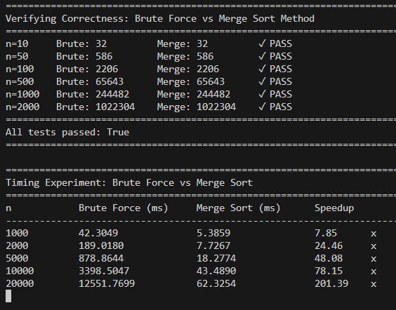

# Lab 5 - Quicksort Variants Analysis

## Question 1: Quicksort Variants

This experiment compares four different Quicksort implementations across various input types and sizes to analyze their performance characteristics.

### Quicksort Variants Implemented

1. **Lomuto Partition** - Uses the last element as pivot
2. **Hoare Partition** - Uses the first element as pivot
3. **Randomised Quicksort** - Selects a random pivot
4. **Three-way (Dutch National Flag) Quicksort** - Partitions into three regions: < pivot, = pivot, > pivot

### Experimental Setup

**Input Sizes:** 1,000; 2,000; 4,000; 8,000; 16,000

**Input Types:**
- Random arrays
- Already sorted arrays
- Reverse sorted arrays
- Arrays with many duplicates (values from 0 to 9)

**Metrics Measured:**
- Number of comparisons
- Execution time (milliseconds)

**Optimization:** All implementations recurse on the smaller partition and loop on the larger one to prevent stack overflow on sorted inputs.

### Results

#### Comparison Counts Across All Input Types



#### Execution Time Across All Input Types



#### Detailed Analysis by Input Type

**Random Input - Comparison Counts**



**Sorted Input - Comparison Counts**



**Duplicates Input - Comparison Counts**



### Key Findings

#### Variants that Degrade to Θ(n²)

**1. Lomuto Partition**
- **Degrades on:** Already sorted, reverse sorted, and many duplicates
- **Why:** Uses last element as pivot. In sorted/reverse sorted arrays, the pivot is always the largest/smallest element, creating highly unbalanced partitions (n-1, 0). This leads to the recurrence T(n) = T(n-1) + Θ(n) = Θ(n²).

**2. Hoare Partition**
- **Degrades on:** Already sorted and reverse sorted inputs
- **Why:** Uses first element as pivot. Same issue as Lomuto - creates unbalanced partitions on sorted inputs. Performs better than Lomuto on duplicates due to more efficient swapping.

**3. Three-way Quicksort**
- **Degrades on:** Reverse sorted inputs (due to using first element as pivot)
- **Why:** Still vulnerable to sorted inputs but exceptionally good on duplicates. The three-way partition groups equal elements together and excludes them from recursion, preventing quadratic behavior on duplicate-heavy inputs.

#### Variants that Maintain Θ(n log n)

**4. Randomised Quicksort**
- **Performs well on:** ALL input types
- **Why:** Random pivot selection ensures expected balanced partitions. Maintains consistent Θ(n log n) behavior regardless of input pattern. Worst-case is still Θ(n²) but probability is extremely low (1/n!).

### Summary Table

| Variant | Random | Sorted | Reverse Sorted | Duplicates |
|---------|--------|--------|----------------|------------|
| Lomuto | Θ(n log n) | Θ(n²) | Θ(n²) | Θ(n²) |
| Hoare | Θ(n log n) | Θ(n²) | Θ(n²) | Θ(n log n)* |
| Randomised | Θ(n log n) | Θ(n log n) | Θ(n log n) | Θ(n log n) |
| Three-way | Θ(n log n) | Θ(n log n)* | Θ(n²)* | Θ(n log n) |

*Hoare performs better on duplicates than Lomuto but still shows some degradation. Three-way degrades on reverse sorted due to pivot selection but excels on duplicates.

### Files

- `Q1.py` - Complete implementation of all four Quicksort variants with experimental runner
- `Q1_Analysis.md` - Detailed analysis with complete data tables and theoretical explanations

### Running the Code

```bash
python Q1.py
```

The program will:
1. Run all four Quicksort variants on all input types and sizes
2. Measure comparisons and execution time
3. Display detailed results for each variant
4. Show summary tables comparing all variants

---

## Question 2: Counting Sort and Radix Sort

This experiment compares linear-time sorting algorithms (Counting Sort and Radix Sort) with comparison-based sorting (Merge Sort) to understand when each approach is optimal.

### Algorithms Implemented

1. **Stable Counting Sort** - Sorts integers in range [0, k] with O(n + k) time complexity
2. **LSD Radix Sort** - Uses counting sort on each digit (base 10 and base 256)
3. **Merge Sort** - Comparison-based O(n log n) sort from Lab 1

### Experimental Setup

**Experiment 1: Counting Sort**
- Fixed n = 100,000
- Varying k = 10, 10³, 10⁵, 10⁷
- Compares counting sort vs merge sort

**Experiment 2: Radix Sort**
- Fixed k = 10⁹
- Varying n = 10,000 to 1,000,000
- Compares radix sort (base 10 and base 256) vs merge sort

**Stability Demonstration:**
- Sorts (key, original index) pairs to prove counting sort preserves order of equal elements

### Results

#### Counting Sort vs Merge Sort (Fixed n, Varying k)



#### Radix Sort vs Merge Sort (Fixed k, Varying n)



#### Overall Performance Comparison



### Key Findings

#### When Linear-Time Sorts Win

**1. Counting Sort wins when k is small relative to n**
- Time complexity: O(n + k)
- When k << n, the O(k) term is negligible
- For n=100,000: wins at k=10 (11ms vs 334ms) and k=10³ (17ms vs 344ms)
- **Ratio:** 0.03x to 0.05x faster than merge sort

**2. Radix Sort wins for large n with large k**
- Base 256 is significantly faster than base 10 (fewer passes needed)
- For n=1,000,000 with k=10⁹: base 256 (1666ms) vs merge sort (4359ms)
- **Ratio:** ~0.38x faster than merge sort
- Base 10 is competitive for smaller n but slower for very large n

#### When Linear-Time Sorts Lose

**1. Counting Sort loses when k is large**
- When k >> n, the O(k) term dominates
- Memory usage becomes prohibitive (O(k) space)
- For n=100,000: loses at k=10⁷ (1156ms vs 346ms)
- **Ratio:** 3.34x slower than merge sort

**2. Radix Sort loses when:**
- Number of digits is large (many passes required)
- n is very small (overhead of digit extraction)
- For n=10,000: base 10 (44ms) vs merge sort (30ms)

#### Merge Sort Characteristics

**Consistent Performance:**
- Always O(n log n) regardless of input range
- Works well when k is very large or unknown
- More memory efficient than counting sort for large k
- No dependency on value range

### Stability Demonstration

Counting sort is proven stable by sorting (key, original index) pairs:
- Original: `[(5,0), (3,1), (5,2), (1,3), (3,4), (5,5), (1,6), (3,7)]`
- Sorted: `[(1,3), (1,6), (3,1), (3,4), (3,7), (5,0), (5,2), (5,5)]`
- For equal keys, original indices remain in ascending order

### Summary Table

| Algorithm | Best Case | Worst Case | Space | When to Use |
|----------|-----------|------------|-------|-------------|
| Counting Sort | O(n + k) | O(n + k) | O(n + k) | Small k relative to n |
| Radix Sort (Base 10) | O(d·(n+b)) | O(d·(n+b)) | O(n + b) | Large n, moderate digit count |
| Radix Sort (Base 256) | O(d·(n+b)) | O(d·(n+b)) | O(n + b) | Large n, want fewer passes |
| Merge Sort | O(n log n) | O(n log n) | O(n) | General purpose, unknown k |

Where d = number of digits, b = base

### Files

- `Q2.py` - Complete implementation of counting sort, radix sort, and merge sort with experiments
- `Lab1_AS26/Lab1_Q2.py` - Original merge sort implementation from Lab 1

### Running the Code

```bash
python Q2.py
```

The program will:
1. Demonstrate stability of counting sort with (key, index) pairs
2. Run counting sort vs merge sort with varying k (fixed n)
3. Run radix sort (base 10 and 256) vs merge sort with varying n (fixed k)
4. Generate plots showing performance comparison
5. Provide analysis of when each algorithm wins/loses

---

## Question 3: Counting Inversions

This experiment compares two methods for counting inversions in an array and applies the efficient method to compute Kendall tau distance between rankings.

### Algorithms Implemented

1. **Brute-Force Inversion Count** - O(n²) - Checks every pair (i, j) where i < j
2. **Merge-Sort-Based Inversion Count** - O(n log n) - Counts inversions during merge sort
3. **Kendall Tau Distance** - Uses merge-sort-based inversion count to measure ranking similarity

### Experimental Setup

**Verification:**
- Test both methods on random arrays of size up to 2,000
- Verify they produce identical results

**Timing Experiment:**
- Time both methods for n = 1,000 to 1,000,000
- Stop brute force when it exceeds 60 seconds
- Measure speedup of merge-sort-based method

**Kendall Tau Application:**
- Compute similarity between two users' rankings of 10 movies
- Interactive input from keyboard
- Returns distance (number of disagreements) and similarity (normalized 0-1)

### Results

#### Correctness Verification

Both methods produce identical results for all test sizes (10 to 2,000):
- ✓ All tests passed

#### Timing Comparison



| n | Brute Force (ms) | Merge Sort (ms) | Speedup |
|---|-----------------|-----------------|---------|
| 1,000 | 42.30 | 5.39 | 7.85x |
| 2,000 | 189.02 | 7.73 | 24.46x |
| 5,000 | 878.86 | 18.28 | 48.08x |
| 10,000 | 3,398.50 | 43.49 | 78.15x |
| 20,000 | 12,551.77 | 62.33 | 201.39x |
| 50,000 | > 60,000 | 195.62 | N/A |

**Key Observations:**
- Brute force exceeded 60 seconds at n=50,000
- Merge sort method completed in under 200ms even at n=50,000
- Speedup increases dramatically with array size (from 7.85x to 201.39x)
- Merge-sort-based method scales as O(n log n) while brute force scales as O(n²)

#### Kendall Tau Distance Examples

**Example 1: Completely opposite rankings**
- User 1: [1, 2, 3, 4, 5, 6, 7, 8, 9, 10]
- User 2: [10, 9, 8, 7, 6, 5, 4, 3, 2, 1]
- Distance: 45 (maximum possible for 10 items)
- Similarity: 0.0000 (completely different)

**Example 2: Nearly identical rankings**
- User 3: [1, 2, 3, 4, 5, 6, 7, 8, 9, 10]
- User 4: [1, 3, 2, 4, 5, 6, 7, 8, 9, 10] (only swap 2 and 3)
- Distance: 1
- Similarity: 0.9778 (nearly identical)

### Key Findings

#### Algorithm Comparison

**Brute-Force Method:**
- Time Complexity: O(n²)
- Space Complexity: O(1)
- Simple to implement
- Becomes impractical for n > 20,000

**Merge-Sort-Based Method:**
- Time Complexity: O(n log n)
- Space Complexity: O(n)
- More complex implementation
- Efficient even for n > 1,000,000

#### Kendall Tau Distance

**Definition:**
- Number of pairwise disagreements between two rankings
- Equivalent to counting inversions when mapping one ranking to another
- Maximum distance for n items: n(n-1)/2

**Applications:**
- Measuring similarity between user preferences
- Comparing search engine result rankings
- Evaluating recommendation systems
- Statistical correlation analysis

**Interpretation:**
- Distance = 0: Identical rankings
- Distance = n(n-1)/2: Completely opposite rankings
- Similarity = 1 - (distance / max_distance): Normalized [0, 1]

### Files

- `Q3.py` - Complete implementation of both inversion count methods and Kendall tau distance calculator

### Running the Code

```bash
python Q3.py
```

The program will:
1. Verify correctness of both methods (sizes 10 to 2,000)
2. Run timing experiment (n = 1,000 to 1,000,000)
3. Demo Kendall tau with example rankings
4. Optionally allow interactive input for custom movie rankings
