# CSF302 - Algorithm Design & Analysis

## Lab 3

## Q1: Matrix Multiplication — Strassen's vs Traditional

### Matrix size: 2×2

In this experiment, the multiplication of two 2 × 2 matrices using the Traditional Matrix Multiplication method and the Strassen's Method was carried out. Matrix A was [2 0; 8 2], Matrix B was [4 1; 1 8]. The result of both calculations was [8 2; 34 24]. Thus, it can be concluded that both methods give the same result. The Traditional Method took 0.000270 seconds and Strassen's Method took 0.000300 seconds. Therefore, for the given matrix size, the Traditional Matrix Multiplication method was slightly more efficient. However, Strassen's Method can be more efficient for larger matrix sizes.

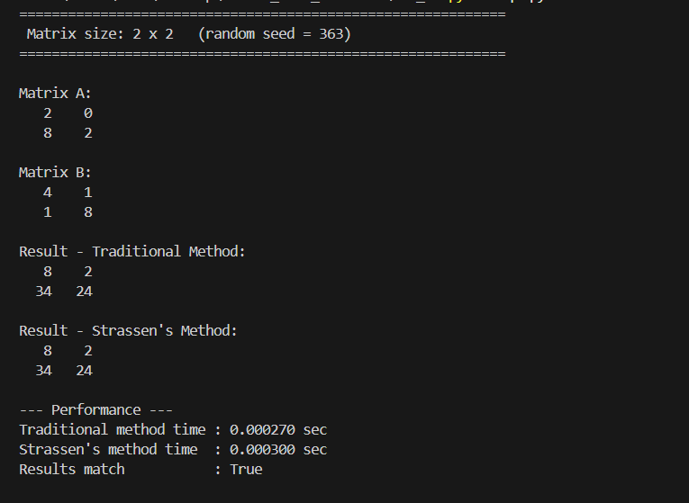

### Matrix 4×4

In the experiment described in the paper, two 4 × 4 matrices were multiplied using the Traditional Matrix Multiplication approach and Strassen's Method. As a result, the same matrix was obtained by the two methods, [69 64 61 59; 69 30 52 66; 98 52 80 76; 100 60 78 76]. Thus, it was found that the results of the two methods coincide. The calculation times for the Traditional and Strassen's approaches were 0.000054 and 0.000182 seconds, respectively. Therefore, the Traditional Matrix Multiplication method was faster for a 4 × 4 matrix. It was also found that Strassen's Method has overhead that makes it more suitable for larger matrix sizes.

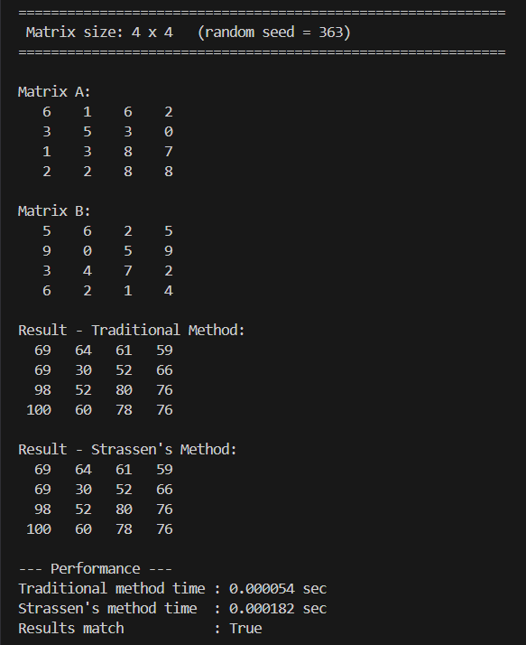

### Matrix size 8×8

In the course of the experiment, the multiplication of the 8 × 8 matrices was performed using two methods, namely, the Traditional Matrix Multiplication method and Strassen's Method. Both algorithms yielded the same result, which proved their correctness since the matrices were multiplied correctly. The traditional method took 0.001072 seconds compared to 0.006249 seconds for Strassen's. Thus, for matrices of such a small size, the Traditional Method is significantly more efficient. However, it must also be noted that Strassen's Method is designed to operate on very large matrices, and the algorithm's efficiency grows in comparison to the traditional one as the size of the matrices increases.

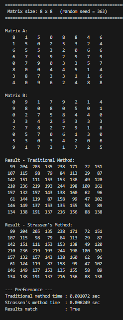

### Matrix 16, 32, 64, 128

The experiments were carried out on matrices of sizes 16 × 16, 32 × 32, 64 × 64, and 128 × 128 with the application of two algorithms for matrix multiplication. Both the Traditional and Strassen's Method produce correct results for all the sizes. The time taken for the Traditional Method was 0.000712, 0.002987, 0.064457, and 0.176811 seconds for matrices of sizes 16 × 16, 32 × 32, 64 × 64, and 128 × 128, respectively. Similarly, the time taken for the Strassen's Method was 0.007092, 0.158461, 0.344498, and 2.085368 seconds for the same sizes of the matrices. It can be concluded that Traditional Method outperforms Strassen's Method in terms of speed. The reason for such results might be the overhead of extra computations in case of Strassen's Method which appear to be especially noticeable in the implementation under consideration. However, it should be noted that Strassen's algorithm theoretically has a better time complexity and thus might be more efficient for large matrices.

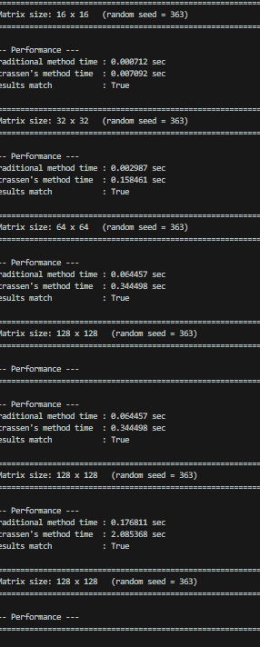

### Summary

Overall, the experiment tested the Traditional and the Strassen's matrix multiplication methods on matrices of 2 × 2 size up to 128 × 128. Both methods demonstrated the same results for each matrix size, which implies their correctness. However, the Traditional Method was consistently faster than Strassen's, with 0.000054 – 0.176811 seconds of execution time, compared to 0.000182 – 2.085368 seconds for the latter. Therefore, the hypothesis was partially proved, as Traditional Method is more efficient for any matrix size from 2 × 2 to 128 × 128. In the future, it would be interesting to test a greater number of matrix sizes, as well as to find out if an optimized implementation of Strassen's method would be faster than the Traditional one.

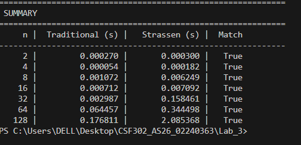

---

## Q2: Karatsuba's Algorithm for Large Integer Multiplication
### size 8

In this experiment, two 8-digit numbers, namely, X = 30824118 and Y = 71623530 were multiplied with each other using the Traditional Multiplication method and Karatsuba's Method. Both calculations yielded the same result, which was 2,207,732,140,296,540, and both were correct. The calculation using the Traditional Method took 0.000071 seconds, whereas, Karatsuba's Method took 0.002683 seconds. Therefore, for small-sized inputs like 8-digit numbers, the Traditional Method is more efficient than Karatsuba's Method because the latter has to perform more recursion steps and, thus, has higher overhead. On the other hand, Karatsuba's algorithm is more efficient for very large numbers from a theoretical standpoint.

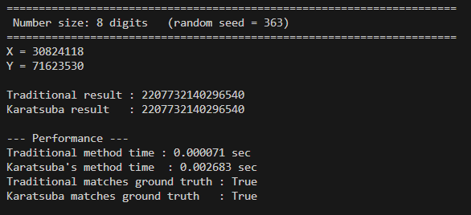
### size 16
In the course of the described experiment, two 16-digit numbers,X = 2387228856259059 and Y = 4472621481508846, were multiplied using the traditional multiplication method and Karatsuba’s algorithm. As a result, the same product of 10677171063782060438838376135914 was obtained using both approaches, which was also confirmed against the ground truth value. The traditional multiplication took 0.000125 seconds to complete, while Karatsuba’s method required 0.000431 seconds. Therefore, for the input size of 16-digit numbers, the traditional algorithm has proven to be more efficient than Karatsuba’s method because the latter involves additional overhead due to recursion. However, it should also be noted that Karatsuba’s algorithm may become more efficient for very large numbers due to its ability to reduce the number of multiplications as compared to the traditional approach.

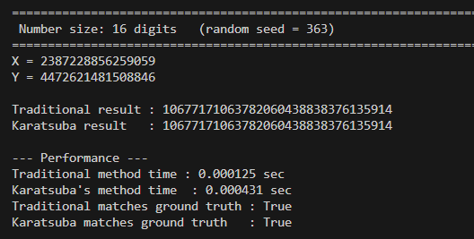

### size 32 and 64
In this experiment, the Traditional and Karatsuba methods were tested with 32-digit and 64-digit numbers. The time needed for the multiplication using the Traditional Method for 32-digit numbers was 0.001909 seconds, while for Karatsuba’s Method, it was 0.004269 seconds for 32-digit numbers. Further, for 64-digit numbers, Traditional Method’s result was 0.010028 seconds, while Karatsuba’s Method was 0.009863 seconds. Both methods were tested using positive integers, and the results matched the ground truth. Thus, the experiment results in Karatsuba’s Method being slightly better for large integers, although it may depend on the input size and implementation.
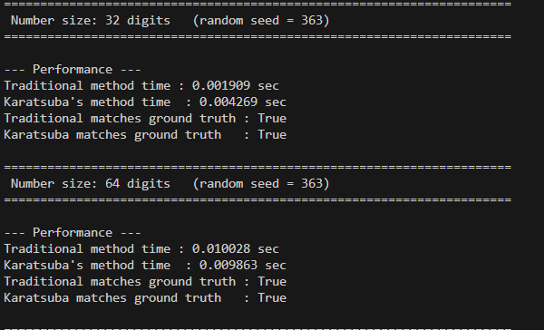

### summary
In general, the experiments comparing the work of Traditional Multiplication and Karatsuba’s Method were conducted for integers with lengths varying from 8 to 1024 digits. Both approaches provided correct results for all the calculations. Nevertheless, the Traditional Method was more efficient for small numbers due to the additional complexities of the recursive algorithm. For larger integers, the Karatsuba’s Method outperformed the Traditional one, with the efficiency margin increasing with the input size. In particular, for the 1024-digit integers, the latter approach took 0.247884 seconds versus 0.134764 seconds for the Traditional Multiplication, which confirms its superior efficiency for large inputs through the reduction of the time complexity.
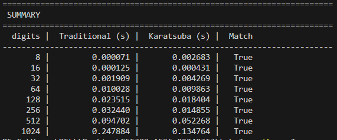

## 3 Binary Search vs Ternary Search (Menu-Driven Program)
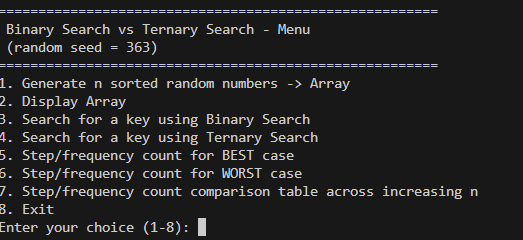
This menu is used to check the difference between the binary search and ternary search algorithms on a given array. It offers you to create an array of random numbers sorted in ascending order and see it on the screen. You can also find the key element using both of these approaches and count the number of steps/frequencies. The best and worst cases are included to compare the amount of operations per array size. It will help you analyze the efficiency of the two algorithms and their behavior with different inputs.

### choice 1 Generate n sorted random numbers -> Array
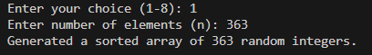
In this experiment, an array of 363 random integers was created using the given random seed. This array was sorted and successfully used to compare the Binary and Ternary searches. The array will be used to determine the searching efficiency by looking at the number of steps that would be taken for the best and worst cases, as well as the performance of the two algorithms for increasing array sizes.

### choice 2 Display Array

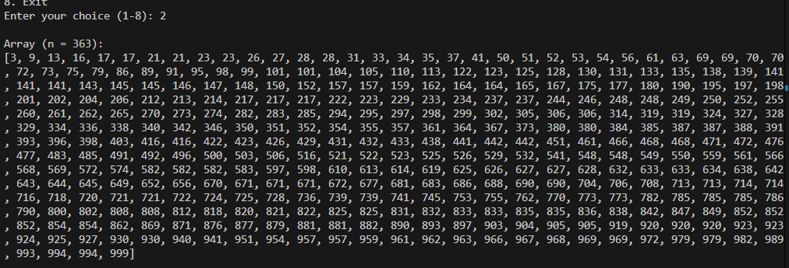
In the experiment, an array of integers was created and displayed correctly. The array was sorted and included 363 random numbers from 3 to 999 arranged in ascending order. Some numbers were repeated; thus, it is possible to find duplicate values. This array was used to perform and compare binary search and ternary search. Using this specific array, I will evaluate the number of searching steps for each algorithm and analyze cases when one method may be more efficient.

### Choice 3 Search for a key using Binary Search
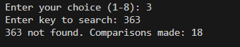
This option allows searching for a specific key in the sorted array using binary search algorithm. The algorithm divides the array in half at each step and compares the middle element with the key, reducing the search space by half each time. The result shows the index where the key was found or indicates if it was not found, along with the number of comparisons made.

### Choice 4 Search for a key using Ternary Search
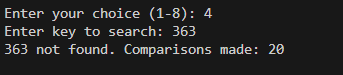
This option performs a search using ternary search algorithm, which divides the array into three parts using two midpoints. It compares the key with elements at both midpoints and narrows down the search to one-third of the original space. The output displays the search result and the total number of comparisons performed.

### Choice 5  Step/frequency count for BEST case
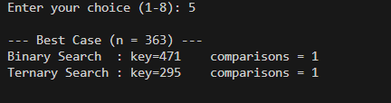
This option analyzes the best-case scenario where the key is found on the first comparison. For binary search, this occurs when the key is at the middle element. For ternary search, it happens when the key matches one of the two midpoints. The comparison counts demonstrate the minimum number of steps required by each algorithm.

### Choice 6  Step/frequency count for WORST case
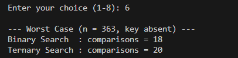
This option evaluates the worst-case scenario where the key is not present in the array, forcing the algorithm to search through all possible partitions. The comparison counts show the maximum number of steps each algorithm requires, highlighting the efficiency difference between binary and ternary search.

### Choice 7  Step/frequency count comparison table across increasing n
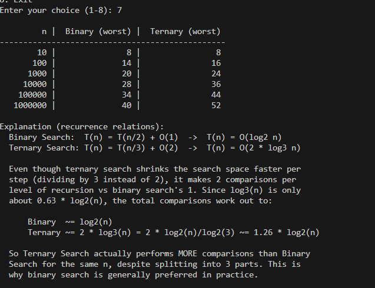
This option generates a comparison table showing the worst-case comparison counts for both algorithms across increasing array sizes (10 to 1,000,000 elements). The table demonstrates that binary search consistently performs fewer comparisons than ternary search, despite ternary search dividing the array into three parts, because it requires two comparisons per level versus one for binary search.

